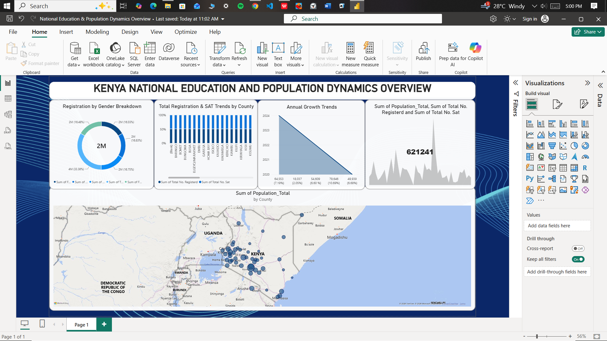

# Kenya National Education & Population Dynamics Dashboard

## 📊 Project Overview
Designed and built an interactive Power BI analytics dashboard tracking national population demographics, school registration rates, and academic performance metrics across Kenyan counties.

## 🖼️ Dashboard Preview

## 🎨 Key Visual Design Interventions
* **Advanced Layout Framing:** Overhauled native layout schemas by applying custom containerization, drop-shadow depth layering, and clean visual padding to maximize dashboard scannability.
* **Text Cleansing:** Standardized cluttered, auto-generated database metric titles into simplified, user-friendly headers.
* **Legend Optimization:** Re-anchored chart legends and streamlined KPI callouts to eliminate text clipping and remove unnecessary automated subtitles.

## 🛠️ Tech Stack
* **Business Intelligence:** Power BI Desktop
* **Data Transformation:** Power Query
* **Geospatial Analysis:** Power BI Native Map Visuals (Kenyan County Boundaries)
